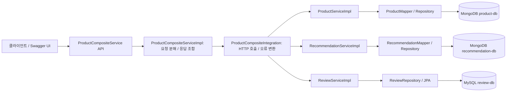

# MSA 영속성 학습 가이드

이 프로젝트는 Java 21 / Spring Boot 4.0.9 기준이다. 책의 예제를 그대로 복사하지 않고 불변 DTO, Jackson 3, Boot 4의 패키지와 설정 이름에 맞춰 적용했다.

## 1. 요청 한 번이 지나가는 경로



복합 서비스는 세 서비스의 DB를 직접 조회하지 않는다. 각 서비스가 자신의 데이터를 소유하고 API로 제공한다. 학습 환경에서는 MongoDB 서버 하나를 공유하지만 product-db와 recommendation-db라는 별도의 논리 DB를 쓴다. 서버 하나를 공유하는 것과 다른 서비스의 컬렉션을 직접 읽는 것은 다르다.

## 2. 클래스별 역할

- API 인터페이스: URL, HTTP 메서드, 요청/응답 타입을 선언하는 계약이다.
- DTO(Product, ProductAggregate 등): HTTP로 주고받는 데이터다.
- ServiceImpl: 입력 검사, 생성/조회/삭제, 예외 변환 등 요청 처리 흐름을 담당한다.
- Entity: DB에 저장하는 구조다. 내부 id와 version은 외부 productId와 다르다.
- Mapper: DTO와 Entity의 필드를 변환한다. DB에 저장하지 않는다.
- Repository: 조회/저장을 수행한다. Spring Data가 인터페이스의 구현을 제공한다.
- Integration: 원격 서비스 API를 호출하는 어댑터다. RestTemplate 호출과 원격 오류 해석을 모은다.

Product는 setter가 없는 불변 DTO이며 기본 생성자도 있다. 이 구조에서 MapStruct가 기본 생성자를 선택하면 모든 값이 기본값인 객체가 만들어질 수 있다. 그래서 현재 entityToApi는 인자 있는 생성자를 명시적으로 호출한다. apiToEntity는 MapStruct가 생성한다. 생성된 build/generated/... 파일은 직접 편집하지 않는다.

추천 엔티티의 rating과 API의 rate는 같은 의미지만 이름이 달라 명시적으로 매핑한다. 추천/리뷰의 content도 복합 요청부터 저장 및 조회 응답까지 전달한다.

## 3. 저장과 동시성

MongoDB의 @Document는 컬렉션, JPA의 @Entity는 테이블에 대응한다. Repository.save()가 실제 저장을 수행한다. API를 호출했다는 사실만으로 데이터가 저장되는 것은 아니다.

productId의 유일성은 DB의 unique index가 보장한다. 코드에서 먼저 존재 여부를 조회하는 것만으로는 두 동시 요청을 막을 수 없다. MongoDB에는 인덱스 생성 설정도 필요하다. 중복 저장 예외는 InvalidInputException으로 바뀌고 HTTP 422로 응답한다.

@Version은 낙관적 잠금을 위한 버전이다. 두 요청이 같은 버전을 읽은 뒤 첫 번째가 수정하면 버전이 증가한다. 두 번째가 이전 버전으로 저장할 때 충돌을 감지한다. 모든 조회를 잠그는 기능은 아니다.

## 4. 복합 생성과 삭제

POST /product-composite는 제품 하나와 선택적인 추천/리뷰 목록을 받는다. 복합 서비스는 이를 개별 DTO로 나누어 각 서비스에 순서대로 POST한다. 목록이 null이면 해당 호출을 생략한다.

DELETE /product-composite/{productId}는 제품 하나와 해당 제품에 속하는 모든 추천/리뷰를 삭제한다. 추천/리뷰의 삭제는 개별 추천 ID가 아니라 productId가 기준이다.

삭제의 멱등성은 여러 번 수행해도 최종 상태가 같다는 의미다. HTTP 규칙 자체가 매번 같은 응답 코드를 강제하는 것은 아니다. 이 책의 API 계약은 이미 없는 데이터도 200으로 응답하도록 선택했다.

원격 404/422는 Integration에서 NotFoundException/InvalidInputException으로 변환하고, 전역 예외 처리기가 클라이언트 응답을 만든다. 그 외 HTTP 오류나 네트워크 오류를 성공으로 숨기지 않는다.

## 5. 실패하면 모두 취소되는가?

아니다. 제품 저장 성공 → 추천 저장 성공 → 리뷰 저장 실패가 발생하면 앞의 두 저장은 남을 수 있다. catch에서 로그를 남기고 예외를 던져도 이전 서비스의 DB 작업은 롤백되지 않는다. 복합 서비스에 @Transactional을 붙이는 것만으로 여러 HTTP 호출을 하나의 DB 트랜잭션으로 만들 수도 없다.

삭제는 이미 삭제한 항목을 다시 삭제해도 괜찮아 재시도가 비교적 쉽다. 생성은 첫 번째 제품이 이미 저장되어 재시도에서 중복 오류가 날 수 있다. 개선에는 요청 식별자를 통한 중복 처리, 재시도 정책, 보상 작업(Saga), Outbox 및 이벤트 기반 처리 등이 필요하다. 리액티브/비동기 방식만으로 이 일관성 문제가 자동으로 해결되지는 않는다. 현재 예제는 이 분산 트랜잭션 문제를 해결하지 않는다.

## 6. 테스트가 보장하는 범위

| 테스트 | 실제 실행하는 부분 | 검증하지 못하는 부분 |
|---|---|---|
| MapperTests | 객체 필드 변환 | DB, HTTP |
| PersistenceTests | Spring Data + 별도 MongoDB 컨테이너 | HTTP API |
| ProductServiceApplicationTests | Product HTTP API + 실제 테스트 DB | 다른 서비스와의 통합 |
| ProductCompositeServiceApplicationTests | 복합 HTTP API와 조합 로직 | mock으로 대체한 핵심 서비스의 DB |
| ProductCompositeIntegrationTests | RestTemplate 요청 URL/메서드와 오류 변환 | 실제 네트워크/DB |
| Compose 수동 테스트 | 실제 서비스 + MongoDB + MySQL | 별도로 주입하지 않은 장애 시나리오 |

@BeforeEach는 각 테스트 전에 데이터를 정리해 실행 순서에 따른 영향을 줄인다. DB 테스트는 Testcontainers의 별도 DB를 사용한다. @DataMongoTest 자체가 MongoDB 서버를 띄우는 것은 아니다. assertEqualsProduct는 직접 작성한 비교 헬퍼이며 JUnit 내장 메서드가 아니다.

## 7. Docker 네트워크와 준비 상태

호스트에서 앱을 실행하면 DB 주소는 localhost이다. 컨테이너 안의 localhost는 자기 컨테이너이므로 Docker 프로필에서는 mongodb 또는 mysql이라는 Compose 서비스 이름을 쓴다.

외부에서 복합 API에 접근하는 주소는 localhost:8080이다. 컨테이너끼리는 product:8080, recommendation:8080, review:8080으로 통신한다. DB 포트는 로컬 개발을 위해 127.0.0.1에만 공개했다.

healthcheck는 DB가 쿼리에 응답하는지 검사한다. depends_on + service_healthy는 DB가 준비된 후 핵심 서비스를 시작시킨다. 시작 이후 DB 장애까지 복구하거나 모든 요청 성공을 보장하지는 않는다.

이 프로젝트는 DB 이름별 named volume을 사용한다. 일반적인 docker compose down 후에도 DB 데이터는 남는다. 컨테이너 재생성과 데이터 초기화는 다르다.

Boot 4 연결 설정: spring.mongodb.host/port/database. spring.data.mongodb.auto-index-creation은 별도의 Spring Data 설정이다. MySQL에는 spring.datasource.*, JPA에는 spring.jpa.*를 사용한다.

ddl-auto: update는 학습용 스키마 갱신 설정이다. 운영에서는 버전 관리된 마이그레이션과 validate/none을 검토한다. SQL 바인딩 TRACE 로그와 예제 DB 비밀번호 역시 로컬 학습 설정이다.

## 8. 실행 및 직접 확인

Docker Desktop의 Linux 엔진이 실행되고 Ubuntu-24.04 WSL 연동이 켜져 있어야 한다. 테스트도 Docker가 필요하다. WSL 터미널에서 실행한다.

```bash
cd /home/user/projects/some-temp-folder
export JAVA_HOME=/home/user/.sdkman/candidates/java/21-tem
export PATH="$JAVA_HOME/bin:$PATH"
./gradlew build
docker compose config --quiet
docker compose build
docker compose up -d
docker compose ps
```

전체 build는 DB 테스트까지 실행한다. Docker 없이 통과한 검사와 DB 통합 테스트는 구분해야 한다. DB 컨테이너만 기동해 로컬 앱을 실행하려면 docker compose up -d mongodb mysql을 사용한다.

Swagger UI: http://localhost:8080/openapi/swagger-ui.html

POST /product-composite에 다음 예제를 보낸다. 이미 사용한 productId라면 다른 번호를 선택한다.

```json
{
  "productId": 123456,
  "name": "Book example",
  "weight": 10,
  "recommendations": [
    {"recommendationId": 1, "author": "Kim", "rate": 5, "content": "Recommended"}
  ],
  "reviews": [
    {"reviewId": 1, "author": "Lee", "subject": "Good", "content": "Review text"}
  ]
}
```

GET /product-composite/123456으로 내용이 보존되는지 확인하고, 같은 POST를 다시 보내 422를 확인한다. DELETE를 두 번 보내 모두 200인지 확인한 다음 GET은 404가 되는지 확인한다.

DB 확인은 생성 직후에 수행하면 된다.

```bash
docker compose exec mongodb mongosh --quiet
```

```javascript
use product-db
db.products.find({productId: 123456})
use recommendation-db
db.recommendations.find({productId: 123456})
exit
```

```bash
docker compose exec mysql mysql --user=user -p review-db
```

예제 비밀번호는 pwd이다. MySQL 프롬프트에서:

```sql
SHOW TABLES;
SELECT * FROM reviews WHERE product_id = 123456;
exit
```

삭제 이후 같은 쿼리로 남은 데이터가 없는지 확인한다.

## 참고

- https://docs.spring.io/spring-boot/4.0/appendix/application-properties/
- https://docs.docker.com/compose/how-tos/startup-order/
- https://docs.jboss.org/hibernate/orm/7.0/introduction/pdf/Hibernate_Introduction.pdf

## 9. 전체 환경 자동화 테스트

`test-em-all.bash`는 서비스 준비를 확인한 뒤 복합 API로 테스트 데이터를 삭제·재생성한다.

```bash
./test-em-all.bash start stop
```

이미 실행 중인 환경에는 `./test-em-all.bash`를 사용한다. 기본 주소는 localhost:8080이며 HOST와 PORT 환경변수로 바꿀 수 있다. curl과 jq가 필요하고, start/stop 옵션에는 Docker Compose도 필요하다. 이 스크립트는 이미지를 빌드하지 않으므로 코드 변경 후에는 먼저 JAR와 Docker 이미지를 빌드한다.

- 준비 확인: DELETE /product-composite/13이 200이 될 때까지 기다린다. 이 경로는 제품·추천·리뷰 서비스 모두를 호출하고, 13을 없는 제품 테스트용으로 정리한다.
- 제품 1: 추천 3개, 리뷰 3개를 생성한다.
- 제품 113: 추천 없이 리뷰 3개를 생성한다.
- 제품 213: 리뷰 없이 추천 3개를 생성한다.
- 각 생성 전에 해당 ID를 삭제하며 삭제와 생성의 응답 코드가 모두 200인지 확인한다.
- 조회 결과의 제품 필드, 자식 개수와 content, 제품 13의 404, 음수 ID의 422를 검증한다.

실행 대상의 ID 1·13·113·213 데이터가 삭제 또는 교체된다. 학습용 환경을 대상으로 실행한다. stop 옵션은 테스트 실패 시에도 Compose 환경을 내리며 named volume은 삭제하지 않는다. 실패하면 종료 코드가 0이 아니므로 CI에서도 사용할 수 있다.

검증 기록: Bash 문법 검사와 임시 HTTP 서버 기반 반복 초기화, 생성 실패, 잘못된 데이터 응답, 준비 실패 검사를 통과했다. 이 검증은 실제 DB와 Compose 전체 환경 테스트를 대신하지 않는다.
